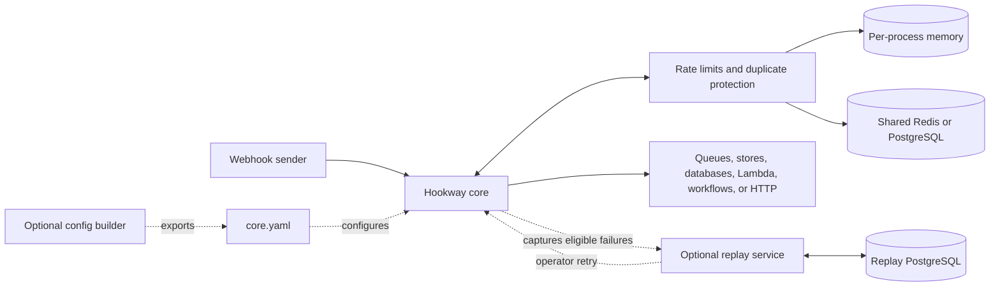

# Hookway

Receive, verify, and route webhooks to the systems you already run.
Hookway is self-hosted: configure flows in YAML or export them from the visual
builder, then run core as a Go binary or Docker container.

## Features

- **Verify senders:** HMAC and ECDSA signatures, HTTP Basic, exact tokens, and JWT.
  Verify the original request before business transforms.
- **Control traffic:** in-flight limits, IP allowlists, loop detection, rate limits,
  and duplicate protection. Use memory for one process or Redis/PostgreSQL to
  share rate limits and duplicate reservations across replicas.
- **Read events and files:** JSON, ordered XML, multipart uploads, and raw bodies.
- **Validate and transform:** JSON Schema checks, explicit type conversions, field
  mapping, JSON change detection, XML edits, and sandboxed JavaScript.
- **Choose delivery paths:** filters, if/else, switches, dynamic environment
  routing, named HTTP/PostgreSQL/DynamoDB lookups, and bounded batch processing.
- **Publish directly:** RabbitMQ, SQS, SNS, Kafka, Redis streams/lists/Pub/Sub/key-value,
  PostgreSQL, MongoDB, S3, Lambda, HTTP webhooks, and Temporal workflow starts.
  Store decoded upload bytes in S3 or Redis key/value storage.
- **Call HTTP APIs:** forward requests, manage outbound credentials, and return
  upstream responses to the caller.
- **Recover failures:** optional replay service and console to inspect, download,
  retry, dismiss, or investigate missed deliveries after the sender got a success
  response. Recovery is operator initiated; capture is best effort.
- **Monitor operations:** Prometheus metrics, Grafana dashboards, health/readiness
  probes, and graceful shutdown.
- **Author visually:** a browser builder with Go/WASM validation and YAML export.
  It creates configuration; it does not manage a running server.

Your applications own queue consumption and business processing. A successful
response means the [acknowledgement policy you configured](docs/operations/delivery-guarantees.md),
not exactly-once processing. Async HTTP delivery uses a process-local memory queue.

## Quick start

With Docker and Docker Compose installed:

```sh
make dev-up
```

Open the [replay console](http://localhost:8082) or
[builder](http://localhost:8082/builder). The
[local development guide](docs/development/local-development.md) has the sign-in
key, a signed webhook example, and a failure/retry walkthrough.

For a minimal core configuration, start with [examples/config.yaml](examples/config.yaml).
See [all examples](examples/README.md), [configuration](docs/reference/configuration.md),
and [CLI commands](docs/reference/cli.md).

## How it fits together



Protection uses the store selected in YAML. Replay has its own PostgreSQL store.
Flows are typed node graphs; see [pipeline invariants](docs/development/invariants.md)
for ordering rules and recovery limits.

## Learn more

- [Documentation](docs/README.md): references, feature guides, and operations.
- [Docker images](docs/dockerhub/README.md): core, replay, and frontend packaging.
- [Security](docs/reference/security.md) and [vulnerability reporting](SECURITY.md).
- [Contributing](CONTRIBUTING.md) and [extending Hookway](docs/development/extending-hookway.md).
